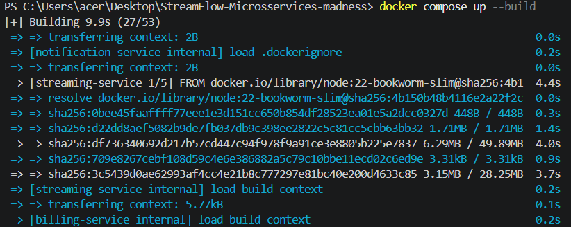

# Evidências — Análise Crítica da Arquitetura StreamFlow

**Disciplina:** Serviços Web · IFSul — Campus Passo Fundo
**Autoria:** helenzn
**Commit analisado:** `ea0c63bc097304d87e7fcb8fa690d7d13d6c8ffa`

Registro dos testes, leituras de código e bloqueios usados como base para o relatório, organizados pelas seis seções do README e pela tarefa bônus.

---

## Índice

0. [Ambiente e preparação](#0-ambiente-e-preparação)
   - [Versões](#versões)
   - [Como subir o laboratório](#como-subir-o-laboratório)
   - [Legenda dos registros](#legenda-dos-registros)
   - [B01 — Login falhava no Windows PowerShell](#b01--bloqueio-de-preparação-login-falhava-no-windows-powershell)
1. [Seção 1 — Custo Operacional Oculto](#seção-1--custo-operacional-oculto)
   - [A02 — Inventário de artefatos](#a02--inventário-de-artefatos)
2. [Seção 2 — Latência de Rede](#seção-2--latência-de-rede)
   - [A01 — Cadeia de chamadas do POST /streaming/play](#a01--leitura-de-código-cadeia-de-chamadas-do-post-streamingplay)
   - [E02 — Cenário 1: latência do play × catálogo](#e02--cenário-1-latência-do-play--catálogo)
   - [E03 — Cenário 2: play com o notification-service parado](#e03--cenário-2-play-com-o-notification-service-parado)
   - [E05 — Timeout com o notification-service congelado](#e05--experimento-adicional-timeout-com-o-notification-service-congelado)
3. [Seção 3 — Observabilidade Frágil](#seção-3--observabilidade-frágil)
   - [E01 — Health check reporta "degraded" com todos os serviços "ok"](#e01--cenário-4-health-check-do-gateway-reporta-degraded-com-todos-os-serviços-ok)
   - [E06 — Health check com serviços parados](#e06--cenário-4-health-check-com-serviços-parados)
4. [Seção 4 — Consistência Eventual](#seção-4--consistência-eventual)
   - [A03 — Autenticação, rastreamento e cópias de IDs](#a03--leitura-de-código-autenticação-rastreamento-e-cópias-de-ids)
5. [Seção 5 — Lei de Conway](#seção-5--lei-de-conway)
6. [Seção 6 — O Caso Prime Video](#seção-6--o-caso-prime-video)
   - [E04 — Cenário 3: analytics com o billing-service parado](#e04--cenário-3-analytics-com-o-billing-service-parado)
7. [Bônus — Moleculer.js](#bônus--moleculerjs)

---

## 0. Ambiente e preparação

### Versões

| Ferramenta | Versão |
|---|---|
| Commit (`git rev-parse HEAD`) | `ea0c63bc097304d87e7fcb8fa690d7d13d6c8ffa` |
| Docker (`docker --version`) | 29.9.2, build a82e528 |
| Docker Compose (`docker compose version`) | v5.6.1 |
| jq (`jq --version`) | jq-1.8.2 |
| Sistema | Windows, Windows PowerShell |

### Como subir o laboratório

```powershell
docker compose up --build   # primeira vez (build das imagens)
docker compose up -d        # subir em segundo plano
docker compose ps           # conferir se os 8 contêineres estão Up
```



### Legenda dos registros

| Letra | Significa | O que é |
|---|---|---|
| **E** | Evidência | Teste executado e medido |
| **B** | Bloqueio | Problema de preparação do ambiente (não é comportamento arquitetural) |
| **A** | Análise | Leitura de código, sem execução |


### B01 — Bloqueio de preparação: login falhava no Windows PowerShell

> **Classificação:** bloqueio de preparação do ambiente de teste. **Não** é um comportamento arquitetural do StreamFlow. Fica registrado conforme o enunciado pede ("registre o erro e os passos tentados").

**Data:** 02/11/2026
**Ambiente:** Windows, Windows PowerShell, `Invoke-RestMethod`

#### Comando
```powershell
$TOKEN = (Invoke-RestMethod -Method Post -Uri http://localhost:8080/auth/login -ContentType "application/json" -Body '{"email":"admin@streamflow.com","password":"admin123"}').token
```

#### Resposta obtida
```json
{"statusCode":500,"code":"FST_REPLY_FROM_INTERNAL_SERVER_ERROR",
 "error":"Internal Server Error","message":"expect header not supported"}
```
O token ficou vazio (`$TOKEN.Length` = 0).

#### Causa
O Windows PowerShell envia automaticamente o cabeçalho `Expect: 100-continue` em requisições POST com corpo. O gateway repassa a requisição ao auth-service por meio de um proxy (o código de erro `FST_REPLY_FROM_...` indica o plugin de proxy do Fastify), e esse proxy não aceita esse cabeçalho. Por isso a requisição falhou antes de chegar ao auth-service.

#### Passos tentados
1. `[System.Net.ServicePointManager]::Expect100Continue = $false`: **não resolveu**. A conexão com `localhost:8080` já tinha sido aberta nos testes de health e manteve a configuração antiga.
2. Desativar o cabeçalho diretamente na conexão já existente: **resolveu**.
   ```powershell
   ([System.Net.ServicePointManager]::FindServicePoint("http://localhost:8080")).Expect100Continue = $false
   ```
   Depois disso, o login retornou o token (524 caracteres; o valor foi omitido por segurança).

#### Procedimento adotado nos demais testes
Em todo terminal novo, rodar `[System.Net.ServicePointManager]::Expect100Continue = $false` **antes de qualquer requisição**. Isso também vale para o POST do play.

#### Observação secundária
O gateway respondeu **500 (erro interno do servidor)** para um problema que veio do cliente (um cabeçalho não suportado). Em produção, esse tipo de erro inflaria a contagem de falhas do servidor e confundiria o diagnóstico. Isso tem relação com a [Seção 3 (Observabilidade)](#seção-3--observabilidade-frágil), mas é uma observação lateral, não um resultado central.

---

## Seção 1 — Custo Operacional Oculto

> _"Temos mais gente mantendo infraestrutura do que escrevendo features."_

### A02 — Inventário de artefatos

**Fonte:** `docker-compose.yml`, busca por Dockerfiles e verificação de arquivos de pipeline no repositório.

| Artefato | Quantidade | Detalhes |
|---|---|---|
| Serviços / contêineres | 8 | gateway + 7 microsserviços |
| Dockerfiles | 8 | um por serviço (`gateway/` e `services/*/`) |
| Processos Node.js | 8 | um por contêiner |
| Bancos SQLite (arquivos distintos) | 5 | auth.db, catalog.db, streaming.db, recommendation.db, shared_billing.db |
| Volumes nomeados | 5 | um por banco; `shared-billing-data` é **compartilhado** por billing e analytics |
| Montagem das chaves RSA (`./keys`) | 7 | todos, exceto o notification |
| Redes | 1 | `streamflow-net` (bridge) |
| Porta pública | 1 | 8080 (gateway) |
| Serviço sem banco | 1 | notification-service |
| Pipelines de CI/CD | **não implementados** | `Test-Path` retornou `False` para `.github`, `.gitlab-ci.yml` e `Jenkinsfile` |
| Service mesh / tracing distribuído | **não implementados** | nenhum contêiner nem configuração para isso |
| Monitoramento / métricas | **não implementados** | não há Prometheus, Grafana nem equivalente |
| `healthcheck` no Compose | **não implementado** | `depends_on` só controla a ordem de início, não se o serviço está pronto |

#### Observações
- O gateway e 5 serviços (catalog, streaming, recommendation, billing e analytics) recebem a **chave pública** (`JWT_PUBLIC_KEY_PATH`), mas **só o gateway a usa** (confirmado no A03). Nos outros 5, é configuração mantida sem função.
- O e-mail do gerente fala em "cada um com seu deploy pipeline, seu monitoramento" e cita service mesh e tracing. **Nenhum desses componentes existe no repositório.** Pelo enunciado, isso é premissa do cenário, não fato observado.

> **Análise e proposta:** candidatos à consolidação e estimativa de esforço estão no [relatório, Seção 1](relatorio.md#seção-1--custo-operacional-oculto).

---

## Seção 2 — Latência de Rede

> _"Um clique no Play toca 12 serviços antes do vídeo iniciar."_

### A01 — Leitura de código: cadeia de chamadas do POST /streaming/play

**Fonte:** `services/streaming/index.js` (linhas 56–93), `services/notification/index.js` (linhas 34–36) e `services/analytics/index.js` (linhas 55 e 72)

#### Chamadas HTTP num play bem-sucedido

| # | Origem → Destino | Rota | Tipo |
|---|---|---|---|
| 1 | Cliente → gateway | POST /api/streaming/play | externa |
| 2 | Gateway → streaming-service | POST /streaming/play | interna |
| 3 | Streaming → catalog-service | GET /catalog/:id/license | interna, síncrona (timeout 5 s) |
| 4 | Streaming → recommendation-service | POST /recommendations/viewed | interna, síncrona |
| 5 | Streaming → notification-service | POST /notify | interna, síncrona |

- **Total:** 5 chamadas HTTP (1 externa + 4 internas). Elas envolvem 5 componentes: gateway + 4 serviços (streaming, catalog, recommendation, notification).
- **Confirmado ([A03](#a03--leitura-de-código-autenticação-rastreamento-e-cópias-de-ids)):** o gateway valida o token localmente com a chave pública e **não chama o auth-service** durante o play. São **5 chamadas HTTP**.
- **Alegação dos "12 serviços":** **não confirmada.** O play passa por 4 serviços além do gateway.
- As 3 chamadas internas são **sequenciais** (`await` uma após a outra).

#### Atrasos artificiais encontrados

| Serviço | Atraso | Onde |
|---|---|---|
| notification-service | aleatório, 100–300 ms por notificação | `index.js`, linhas 35–36 |
| analytics-service | 150 ms + 100 ms = 250 ms fixos | `index.js`, linhas 55 e 72 |

#### Candidatas a assíncronas
- **Notificação (#5):** o usuário não precisa esperar a notificação para assistir. Ela pode virar um evento numa fila.
- **Registro de visualização (#4):** alimenta as recomendações e pode ser processado depois.
- **Licença (#3):** precisa continuar síncrona, porque é uma regra de negócio: o usuário só pode assistir se o filme estiver licenciado.

### E02 — Cenário 1: latência do play × catálogo

**Data:** 02/11/2026
**Ambiente:** Windows PowerShell, `Invoke-WebRequest` + `Stopwatch` (o tempo medido inclui a sobrecarga do próprio cliente)
**Condição inicial:** 8 contêineres `Up`, login feito (token omitido), nenhum serviço parado.

#### Comandos
```powershell
# play (repetido 6x)
Invoke-WebRequest -UseBasicParsing -Method Post -Uri http://localhost:8080/api/streaming/play -Headers $H -ContentType "application/json" -Body '{"movieId": 2}'
# catálogo (repetido 6x)
Invoke-WebRequest -UseBasicParsing -Uri http://localhost:8080/api/catalog -Headers $H
```

#### Medições (a nº 1 é aquecimento, fora da estatística)

| # | Play (HTTP / tempo) | Catálogo (HTTP / tempo) |
|---|---|---|
| 1 (aquec.) | 201 / 0,712 s | 200 / 0,031 s |
| 2 | 201 / 0,194 s | 200 / 0,023 s |
| 3 | 201 / 0,265 s | 200 / 0,025 s |
| 4 | 201 / 0,238 s | 200 / 0,023 s |
| 5 | 201 / 0,359 s | 200 / 0,047 s |
| 6 | 201 / 0,203 s | 200 / 0,032 s |

| Rota | Mediana | Mín–Máx | n |
|---|---|---|---|
| POST /api/streaming/play | **0,238 s** | 0,194–0,359 s | 5 |
| GET /api/catalog | **0,025 s** | 0,023–0,047 s | 5 |

#### Interpretação
- **Observação:** a mediana do play foi cerca de **9,5 vezes** a do catálogo (diferença de ≈ 0,21 s). O play respondeu **201 (Created)**: cada chamada cria uma nova sessão de reprodução.
- **Cuidado:** essa diferença **não é toda latência de rede**. Ela soma chamadas entre serviços, escrita em banco e os atrasos artificiais do notification-service. A divisão exata depende da leitura do código do streaming-service (próximo passo).
- **Aquecimento:** a 1ª chamada do play (0,712 s) foi cerca de 3 vezes a mediana, o que é típico de conexões e caches ainda frios. Por isso ela ficou fora da estatística.
- **Limite:** é uma amostra exploratória de 5 medições numa máquina local. Não é um teste de capacidade.

### E03 — Cenário 2: play com o notification-service parado

**Data:** 02/11/2026
**Condição inicial:** `docker compose stop notification-service`; os demais serviços `Up`; login feito (token omitido).

#### Comando (repetido 6x)
```powershell
Invoke-WebRequest -UseBasicParsing -Method Post -Uri http://localhost:8080/api/streaming/play -Headers $H -ContentType "application/json" -Body '{"movieId": 3}'
```

#### Medições

| # | HTTP | Tempo (cliente) | `responseTime` no log do streaming |
|---|---|---|---|
| 1 (aquec.) | 201 | 3,087 s | não capturado |
| 2 | 201 | 1,723 s | 1707 ms |
| 3 | 201 | 1,745 s | 1729 ms |
| 4 | 201 | 1,716 s | 1701 ms |
| 5 | 201 | 1,727 s | 1714 ms |
| 6 | 201 | 1,808 s | 1794 ms |

| Condição | Mediana | Mín–Máx | n |
|---|---|---|---|
| Notification ligado (E02) | 0,238 s | 0,194–0,359 s | 5 |
| **Notification parado** | **1,727 s** | 1,716–1,808 s | 5 |

#### Trecho de log (streaming-service, resumido)
```json
{"level":30,"reqId":"req-2","msg":"incoming request"}
{"level":30,"movieId":3,"userId":"user_1","msg":"Iniciando fluxo de play..."}
{"level":40,"err":{"type":"TypeError","message":"fetch failed: getaddrinfo ENOTFOUND notification-service"},"msg":"Falha ao enviar notificação"}
{"level":30,"reqId":"req-2","res":{"statusCode":201},"responseTime":1707.03,"msg":"request completed"}
```

#### Interpretação
- **Observação:** o play continua funcionando (201: falha silenciosa), mas fica cerca de **7 vezes mais lento**. Remover o atraso artificial do notification (100–300 ms) não compensou o custo da falha.
- **Tipo de falha:** `ENOTFOUND` é uma **falha de resolução de nome (DNS)**. Ao parar o contêiner, o Docker remove o nome dele da rede interna. Isso é diferente de conexão recusada (`ECONNREFUSED`) e de timeout: o tempo ficou abaixo do limite de 5 s do código.
- **Divergência com o DEBUG.md:** o guia sugere "recusa imediata de conexão"; o observado foi uma falha de DNS que levou ~1,7 s. Esse tempo depende do ambiente (Docker Desktop no Windows) e não deve ser generalizado.
- **Consequência:** uma dependência **não essencial** para assistir ao vídeo, chamada de forma síncrona, degrada a experiência de todos os usuários quando cai. É o argumento central para tornar a notificação assíncrona (Seção 2).
- **Observabilidade ([Seção 3](#seção-3--observabilidade-frágil)):** o `reqId` é um contador local do streaming-service, não propagado pelo gateway, e as linhas "Iniciando fluxo" e "Falha ao enviar notificação" **não trazem o reqId**. Com tráfego simultâneo, não seria possível ligar a falha à requisição de origem.
- **Restauração:** `docker compose start notification-service`.

### E05 — Experimento adicional: timeout com o notification-service congelado

**Data:** 03/11/2026. Houve antes uma rodada preliminar, com n = 3.
**Objetivo:** o DEBUG.md afirma que parar o contêiner não demonstra timeout e que seria necessária "uma dependência que aceite a conexão e não responda no prazo". O `docker compose pause` congela os processos do contêiner sem removê-lo da rede, reproduzindo essa condição.
**Condição inicial:** login refeito (token omitido); `docker compose pause notification-service`; demais serviços `Up`.

#### Comando (repetido 6x)
```powershell
Invoke-WebRequest -UseBasicParsing -Method Post -Uri http://localhost:8080/api/streaming/play -Headers $H -ContentType "application/json" -Body '{"movieId": 3}'
```

#### Medições (a nº 1 é aquecimento, fora da estatística)

| # | HTTP | Tempo (cliente) |
|---|---|---|
| 1 (aquec.) | 201 | 5,228 s |
| 2 | 201 | 5,050 s |
| 3 | 201 | 5,083 s |
| 4 | 201 | 5,097 s |
| 5 | 201 | 5,070 s |
| 6 | 201 | 5,060 s |

**Mediana: 5,070 s — mín–máx: 5,050–5,097 s (n = 5).**

**Rodada preliminar (n = 3):** 5,302 s / 5,043 s / 5,059 s. Esses valores são consistentes com a rodada principal, o que mostra que o resultado se repete.

#### Trecho de log (streaming-service, medição 6, resumido)
```json
{"level":30,"reqId":"req-n","req":{"method":"POST","url":"/streaming/play"},"msg":"incoming request"}
{"level":30,"movieId":3,"userId":"user_1","msg":"Iniciando fluxo de play..."}
{"level":40,"err":{"type":"DOMException","name":"TimeoutError","message":"The operation was aborted due to timeout"},"msg":"Falha ao enviar notificação"}
{"level":30,"reqId":"req-n","res":{"statusCode":201},"responseTime":5039.34,"msg":"request completed"}
```
Entre "Iniciando fluxo" (…500790) e o aviso de falha (…505812) passaram **5,022 s**, que é o prazo de `AbortSignal.timeout(5000)` mais uma pequena sobrecarga.

#### Interpretação
- **Observação:** o play continua respondendo 201, mas cada reprodução espera ~5 s, o valor de `AbortSignal.timeout(5000)` na chamada ao notification (`streaming/index.js:90`).
- **Comparação dos modos de falha (mesma dependência):**

| Estado do notification | Erro no log | Mediana do play | Registro |
|---|---|---|---|
| Ligado | — | 0,238 s | E02 |
| Parado (`stop`) | `ENOTFOUND` (DNS) | 1,727 s | E03 |
| Congelado (`pause`) | `TimeoutError` | 5,070 s | E05 |

- **Conexão recusada (`ECONNREFUSED`)** não foi observada em nenhum experimento: parar o contêiner gerou falha de DNS, não recusa.
- **Conclusão:** uma dependência **lenta** causa mais dano que uma dependência **fora do ar**. A falha é silenciosa (201), então nenhum alarme de erro dispararia, mas o usuário espera cerca de **21 vezes mais** (5,070 s ÷ 0,238 s).
- **Projeção (hipótese, não medida):** as três chamadas internas do play são sequenciais e têm timeout de 5 s cada. No pior caso, com as três lentas, a espera passaria de 15 s.
- **Proposta:** tirar a notificação do caminho síncrono (evento em fila); para as chamadas que precisam continuar síncronas, usar um timeout menor e um circuit breaker, que para de chamar uma dependência que já está falhando.
- **Restauração:** `docker compose unpause notification-service`.

---

## Seção 3 — Observabilidade Frágil

> _"Tivemos 3 incidentes e não sabemos nem onde foi."_

**Evidências relacionadas em outras seções:**
- [B01 — Observação secundária](#observação-secundária): gateway responde 500 para erro causado pelo cliente.
- [E03 — Interpretação](#interpretação-1): `reqId` local, não propagado, ausente nas linhas de erro.
- [A03 — Rastreamento](#rastreamento-seção-3): nenhuma propagação de `request-id`, `correlation` ou `traceparent`.

### E01 — Cenário 4: health check do gateway reporta "degraded" com todos os serviços "ok"

**Data:** 02/11/2026
**Ambiente:** Windows, PowerShell, Docker Desktop
**Commit analisado:** `ea0c63bc097304d87e7fcb8fa690d7d13d6c8ffa`
**Versões:** Docker 29.9.2 (build a82e528) / Docker Compose v5.6.1
**Adaptação do roteiro:** o DEBUG.md usa Bash + curl + jq. Usei PowerShell com `Invoke-WebRequest`, porque o ambiente é Windows.

#### Condição inicial
- Os 8 contêineres (gateway + 7 serviços) apareciam como `Up` no `docker compose ps`.
- Nenhum serviço tinha sido parado.
- Os serviços estavam no ar havia cerca de 3,5 minutos (campo `uptime` ≈ 202–219 s), então já tinham terminado de inicializar.

#### Comando
```powershell
try { $r = Invoke-WebRequest -UseBasicParsing http://localhost:8080/health; "http=$($r.StatusCode)"; $r.Content } catch { "http=$([int]$_.Exception.Response.StatusCode)"; $_.ErrorDetails.Message }
```

#### Resultados (3 chamadas seguidas)

| # | HTTP | Status do gateway | Serviços "ok" |
|---|---|---|---|
| 1 | 503 | degraded | 7 de 7 |
| 2 | 503 | degraded | 7 de 7 |
| 3 | 503 | degraded | 7 de 7 |

Uma chamada anterior (uptime ≈ 53 s) teve o mesmo resultado: `degraded` com 7 de 7 serviços `ok`.

#### Trecho da resposta (chamada 1, resumida)
```json
{"service":"gateway","status":"degraded",
 "downstream":{
  "auth-service":{"status":"ok"},
  "catalog-service":{"status":"ok"},
  "streaming-service":{"status":"ok"},
  "recommendation-service":{"status":"ok"},
  "notification-service":{"status":"ok"},
  "billing-service":{"status":"ok"},
  "analytics-service":{"status":"ok"}}}
```

#### Interpretação
- **Observação (medida):** o gateway responde **HTTP 503 / "degraded"** de forma consistente, mesmo com os 7 serviços respondendo `ok`. Isso diverge do DEBUG.md, que diz que o status muda para "degraded" quando um serviço é parado.
- **Consequência:** um monitor automático baseado nesse endpoint ficaria em alerta permanente. Um alarme que nunca desliga perde a utilidade: a equipe se acostuma a ignorar, inclusive quando a falha é real. Isso se relaciona com a Seção 3 (Observabilidade) e com a queixa do gerente de que ninguém sabia onde estava o problema.
- **Hipótese (a confirmar no código):** os horários (`timestamp`) de cada serviço crescem sempre na ordem da lista, o que sugere que o gateway consulta os serviços **um de cada vez**, em sequência, e não em paralelo.
- **Causa (confirmada no código, `gateway/index.js`, linhas 125–144):**
  - Linha 131: `results[name] = { status: 'up', ...data };`. O spread `...data` vem depois e sobrescreve `status: 'up'` com o `status: 'ok'` que o próprio serviço retorna.
  - Linha 137: `every(r => r.status === 'up')` nunca é verdadeiro, então a resposta é sempre 503 / "degraded".
  - **Hipótese de chamadas sequenciais confirmada:** o laço `for ... await` consulta um serviço por vez, com timeout de 3 s cada (pior caso ≈ 7 × 3 s = 21 s).
  - `response.ok` não é verificado: um serviço que responda HTTP 500 com JSON seria marcado como saudável.
  - O `catch` vazio descarta o motivo da falha (conexão recusada, timeout ou JSON inválido aparecem todos apenas como "down").
- **Proposta:** declarar o status depois do spread (`{ ...data, status: 'up' }`) ou comparar com `'ok'`; checar `response.ok`; consultar os serviços em paralelo (`Promise.allSettled`); registrar o motivo da falha.

### E06 — Cenário 4: health check com serviços parados

**Data:** 02/11/2026
**Nota de execução:** por um erro de digitação (dois comandos colados na mesma linha), o billing-service não foi reiniciado após o E04. Isso permitiu medir o health em três condições. Todos os serviços foram restaurados ao final.

#### Comando
```powershell
try { $r = Invoke-WebRequest -UseBasicParsing http://localhost:8080/health; "http=$($r.StatusCode)"; $r.Content } catch { "http=$([int]$_.Exception.Response.StatusCode)"; $_.ErrorDetails.Message }
```

#### Resultados

| Condição | HTTP | Status geral | Serviços "down" | Duração aprox. do health* |
|---|---|---|---|---|
| Nenhum parado (E01) | 503 | degraded | — | < 0,1 s |
| billing parado | 503 | degraded | billing | ~3 s |
| billing + catalog parados | 503 | degraded | billing, catalog | ~7 s |

\* Estimada pela diferença entre os `timestamp` do primeiro serviço consultado e o do gateway na resposta.

#### Trecho da resposta (billing + catalog parados, resumida)
```json
{"status":"degraded","timestamp":"2026-11-03T02:05:58.044Z","downstream":{
 "auth-service":{"status":"ok","timestamp":"2026-11-03T02:05:50.905Z"},
 "catalog-service":{"status":"down"},
 "streaming-service":{"status":"ok","timestamp":"2026-11-03T02:05:53.923Z"},
 "notification-service":{"status":"ok","timestamp":"2026-11-03T02:05:53.931Z"},
 "billing-service":{"status":"down"},
 "analytics-service":{"status":"ok","timestamp":"2026-11-03T02:05:58.043Z"}}}
```

#### Interpretação
- **Observação:** o status geral é o mesmo (503 / degraded) com 0, 1 ou 2 serviços fora do ar. Ele **não distingue** sistema saudável de sistema com falha; só o detalhamento por serviço (`downstream`) mostra a diferença. Isso confirma o bug do E01 e mostra que o Cenário 4 do DEBUG.md não funciona como descrito.
- **Verificação sequencial confirmada na prática:** entre o auth (50,905) e o streaming (53,923) passaram ~3,0 s, gastos esperando o catalog parado; o mesmo aconteceu com o billing. Cada serviço fora do ar acrescenta ~3 s (o timeout do código), e os atrasos se **somam**.
- **Consequência:** justamente durante um incidente, o health fica mais lento. Com os 7 serviços fora, a projeção é de ~21 s (hipótese, não medida).
- **Restauração:** `docker compose start billing-service` e `docker compose start catalog-service`.

> **Análise e proposta:** o que falta para responder "foi AQUI, durou TANTO, afetou TANTOS" e a estratégia de observabilidade estão no [relatório, Seção 3](relatorio.md#seção-3--observabilidade-frágil).

---

## Seção 4 — Consistência Eventual

> _"Recomendações mostrando conteúdo que já foi removido."_

### A03 — Leitura de código: autenticação, rastreamento e cópias de IDs

**Comando:** busca por `AUTH_URL|jwt|verify|request-id|correlation|traceparent|DB_PATH|new Database|movieId` em `gateway/` e `services/`.

#### Autenticação (Seções 1 e 2)
- O gateway valida o token **localmente**: `jwt.verify(token, PUBLIC_KEY, { algorithms: ['RS256'] })` (`gateway/index.js:51`), aplicado como `preHandler` em 5 rotas (linhas 76–108).
- **Não há chamada ao auth-service durante o play.** A contagem do A01 está confirmada: **5 chamadas HTTP**.
- O auth-service só **emite** tokens (`jwt.sign`, `auth/index.js:72`).
- **Configuração sem uso:** catalog, streaming, recommendation, billing e analytics recebem `JWT_PUBLIC_KEY_PATH` e montam `./keys` (A02), mas a busca não encontrou uso de `jwt` ou `verify` nesses serviços.
- **Hipótese a verificar:** como os serviços não validam o token, eles confiam no que o gateway repassa (por exemplo, o `userId`). Qualquer cliente com acesso à rede interna poderia chamá-los diretamente.

#### Rastreamento (Seção 3)
- **Nenhuma ocorrência** de `request-id`, `correlation` ou `traceparent` no gateway nem nos serviços.
- O `reqId` dos logs (E03) é gerado localmente pelo Fastify em cada serviço ("req-1", "req-2"...), reinicia em cada processo e não é repassado nas chamadas internas.
- **Conclusão:** não há como ligar a entrada no gateway às chamadas ao catalog, recommendation e notification de uma mesma reprodução.

#### Cópias de IDs entre serviços (Seção 4)
- O recommendation-service grava o histórico só com o **ID do filme**: `INSERT INTO view_history (user_id, movie_id)` (`recommendation/index.js:76`). Ele valida apenas se os campos existem (linhas 72–73) e **não consulta o catálogo**.
- O streaming-service também grava `(userId, movieId)` no próprio banco (`streaming/index.js:108`).
- **Não há** evento, fila nem rotina de reconciliação entre catalog, recommendation e streaming.
- **Hipótese de projeto** (não demonstrada; o repositório não tem rota de remoção): se um filme sair do catálogo, os IDs continuarão no histórico e nas sessões **indefinidamente**. Isso não é consistência eventual, porque não existe mecanismo que faça os dados convergirem.

#### Banco compartilhado (Seção 6)
- billing e analytics usam o mesmo `shared_billing.db` (`billing/index.js:19` e `analytics/index.js:25`). Isso confirma o acoplamento observado no [E04](#e04--cenário-3-analytics-com-o-billing-service-parado).

---

## Seção 5 — Lei de Conway

> _"Mesma equipe de 15 pessoas operando 7 serviços."_

> Sem registros de teste: os dados sobre equipe e organização são premissas do cenário. A análise está no [relatório, Seção 5](relatorio.md#seção-5--lei-de-conway).

---

## Seção 6 — O Caso Prime Video

> _"O concorrente fez melhor com menos."_

### E04 — Cenário 3: analytics com o billing-service parado

**Data:** 02/11/2026
**Condição inicial:** `docker compose stop billing-service`; demais serviços `Up`.

#### Comando (repetido 6x)
```powershell
Invoke-WebRequest -UseBasicParsing -Uri http://localhost:8080/api/analytics/report -Headers $H
```

#### Medições

| # | HTTP | Tempo |
|---|---|---|
| 1 (aquec.) | 200 | 0,295 s |
| 2 | 200 | 0,273 s |
| 3 | 200 | 0,271 s |
| 4 | 200 | 0,277 s |
| 5 | 200 | 0,270 s |
| 6 | 200 | 0,282 s |

**Mediana: 0,273 s — mín–máx: 0,270–0,282 s (n = 5)**

#### Trecho da resposta
```json
{"summary":{"totalSubscribers":3,"activeSubscribers":3,"monthlyRecurringRevenue":"104.70",
 "totalInvoices":5,"paidInvoices":2,"pendingInvoices":3,"collectionRate":"40.0%"},
 "pipeline":{"stages":["coleta","agregação","formatação"],"totalProcessingTime":"~250ms"}}
```

#### Interpretação
- **Observação:** com o billing-service parado, o analytics continua gerando o relatório financeiro completo (200).
- **Causa (confirmada no `docker-compose.yml` e no A03):** billing e analytics montam o **mesmo volume** (`shared-billing-data`) e usam o **mesmo arquivo** (`shared_billing.db`). O analytics lê as tabelas do billing direto no banco (`SELECT * FROM invoices`, `analytics/index.js:52`), sem passar pela API.
- **Consequência:** são dois serviços "independentes" acoplados pelo banco. Se o billing mudar o schema de `invoices` ou `subscriptions`, o analytics quebra sem aviso, e nenhum contrato de API protege essa dependência.
- **Tempo:** quase todo o tempo (~0,27 s) corresponde aos 250 ms de atraso artificial (A01), não a trabalho real.
- **Pipeline interno:** as três etapas (coleta → agregação → formatação) já rodam **dentro de um único processo**. Esse ponto é central para a comparação com o caso Prime Video.
- **Restauração:** `docker compose start billing-service`.

---

## Bônus — Moleculer.js

> A pesquisa sobre o Moleculer não tem registro de teste. A análise completa (recursos, o que ele esconde, recomendação e referências) está no [relatório, Bônus](relatorio.md#bônus--moleculerjs).
